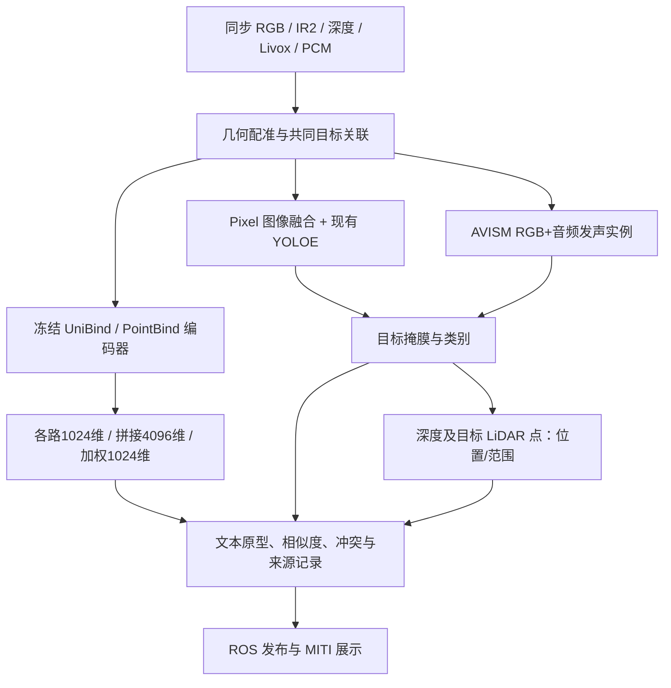

# D435IU、Livox 与声学的免训练融合项目分析

核对日期：2026-11-19。依据官方 README、模型源码、配置、仓库权重文件和公开权重文件夹。这里的“免训练”指使用作者已经训练好的完整模型；新增候选尚未在本机或 Orin 上安装、加载权重和评测。

最适合当前设备的组合是：**现有 UniBind/PointBind 做四路特征提取与拼接；Pixel 图像融合接现有 YOLOE 做 RGB＋NIR 感知；AVISM 做 RGB＋音频的发声实例关联；深度与 Livox 提供目标几何。**这些模块可以组成一条工程流程，但没有一个已核实的模型原生接收当前四路输入并直接输出通用三维实例结果。

**设备与输入的边界**

- D435IU 当前使用 RGB、深度和 IR2 图像。IR2 是近红外强度图，不是 LWIR 热红外、偏振图或按距离切片的门控近红外。共享机身也不意味着 RGB 和 IR2 已逐像素对齐。
- RGB 与 IR2 需结合相机内外参、深度和遮挡处理做重投影；resize 只能改变尺寸，不能修正视差。相机与 Livox 的安装外参仍须实测。
- 当前 Orin 声音入口为单声道。AVISM/AVSegFormer 可使用单声道音频；空间声源模型需要同步多通道、阵列几何及相机/阵列外参。
- “免训练”仍需要同步采集、输入预处理、权重与配置匹配以及 ROS 输出适配。重编译 CUDA 算子或更换推理环境属于部署工作。

**项目逐项判断**

| 项目 | 特征或融合结构 | 现成模型与当前设备的关系 | 判断 |
|---|---|---|---|
| [UniBind/PointBind](https://github.com/QC-LY/UniBind)（补充，现有项目已采用） | 模态编码器→已训练投影→公共 1024 维空间；本项目实现 L2 归一化、4096 维拼接、1024 维加权融合、文本原型比对 | 已有真实权重及冻结推理。NIR 复用视觉分支；点云骨干以物体点云为基础，整场 Livox 扫描存在领域差异 | **四路流程研究首选**；NIR 与场景点云语义准确性未验证 |
| [Pixel-aligned RGB-NIR](https://github.com/divisonofficer/Pixel_aligned_RGB_NIR_Stereo) | 图像版：共享编码器、bAFF、亮度权重预测、HSV 重建与引导滤波。特征版：RAFT-StereoFusion、相关体、GRU | 仓库有图像与特征版完整权重。图像版约 7.57 MB，接收 RGB＋NIR。特征版接收左右 RGB＋左右 NIR，D435IU 当前只有一台 RGB 相机 | **图像版可免训练试用**；四幅图输入的立体特征版不匹配当前硬件 |
| [CFT–YOLOv5](https://github.com/DocF/multispectral-object-detection) | 双 CNN 分支；GPT 模块池化到公共网格、拼接模态 token、自注意力、插值回原尺度 | README 确认 LLVIP/FLIR 融合权重；VEDAI 有实验结果，但当前下载列表未找到对应 NIR 任务权重。热红外权重不等于 D435 NIR 权重 | 适合研究 **token 拼接和多尺度交互**；当前免训练部署优先级低于 Pixel |
| [WeedsGalore](https://github.com/GFZ/weedsgalore) | 五波段输入堆叠→DeepLabv3+，属于输入通道级早期融合 | 有五波段完整权重；D435IU 缺红边波段，波段响应也不同；类别为作物/杂草 | 不适合当前通用巡逻感知；补零或复制波段不能复现原模型输入 |
| [MCubeSNet](https://github.com/kyotovision-public/multimodal-material-segmentation) | 四分支 backbone/ASPP；高低层特征通道拼接；RGFSConv 区域引导特征筛选 | 完整模型使用 RGB、AoLP、DoLP、NIR，还依赖区域引导 mask。代码可将缺失分支置零，但未核实该现成权重在缺偏振时的表现 | 适合研究 **多分支拼接和区域筛选**；不是当前传感器的优先直接部署方案 |
| [ShapeConv](https://github.com/hanchaoleng/shapeconv) | 分解形状/基底分量并施加学习权重，结合 RGB-D 分割网络 | 已核对 model zoo，提供 NYU/SID 等任务权重；未找到表中 TICaM NIR＋Depth 的完整配置权重 | 原 RGB-D 任务可免训练试用；表中的 NIR＋Depth 变体不能直接据此复现 |
| [GatedFusion-Net](https://github.com/martinbrennernz/MM5-Dataset/tree/main/GF-Net) | SegFormer 分层编码、特征注册、拼接后卷积生成逐像素 sigmoid gate、融合与分割解码 | 公开权重文件夹确有 RGB3-DIN 模型，不要求额外 T/UV。配置将 DIN 作为一个打包图像输入，需复现对应编码；公开配置为 32 类，主要包含水果、器物及背景 | **可免训练做 RGB＋NIR＋Depth 结构实验**；类别范围限制通用巡逻应用 |
| [SAMFusion](https://github.com/torc-ai/SAMFusion) | LiDAR 体素/BEV 特征与图像交互；I2P/P2I 等特征增广、拼接和卷积；传感器自适应融合解码 | 有完整 DENSE 权重，但发布的完整配置同时启用 radar、gated、camera、lidar；D435 NIR 不具备门控距离切片 | 不适合当前设备直接复现完整模型。表中所引 CVPR 2020 论文不是 SAMFusion 本文 |
| [Myria3D/FRACTAL](https://huggingface.co/IGNF/FRACTAL-LidarHD_7cl_randlanet) | 每点拼接反射/回波、RGB/NIR、派生颜色/NDVI；RandLA-Net 邻域聚合与多尺度插值 | 有完整权重，但针对航测点云、航片颜色、回波字段和 50 m 地块；模型卡明确说明换移动/地面数据源存在性能下降 | 可研究 **点级特征拼接**；不宜当作免适配的 Livox 场景分割器 |
| [AVSBench](https://github.com/OpenNLPLab/AVSBench) | ResNet/PVT 多尺度特征→公共通道；VGGish→TPAVI；音视频时空交互→mask | README 公布完整 AVSS 任务模型；注意只下载 ResNet/VGGish 骨干不够。需同步 RGB＋音频及原预处理 | **可免训练做音视频分割基线**；具体权重对应二值/语义任务，不能自动得到实例跟踪 |
| [AVSegFormer](https://github.com/vvvb-github/AVSegFormer) | 音频 128→256；视觉 1×1 卷积→256；音频查询＋多尺度 Transformer＋CrossModalMixer | S4、MS3、AVSS 均有完整权重和测试配置；依赖旧版 PyTorch/MMCV 与自定义 MSDeformAttention | **可免训练试用**，适合研究查询式融合、尺度匹配和发声区域分割 |
| [AVISM](https://github.com/ruohaoguo/avis) | 多尺度 1×1 投影；音频 128→hidden；跨注意力；三尺度融合特征拼接→Linear；跨帧窗口注意力 | 有 R50/Swin-L 完整任务权重、评估和演示入口；26 类中确认包含 cat/dog。当前演示读取图像序列和预提取 FEATAudios，而不是直接采集实时 PCM | **发声实例分割/跟踪首选**；需输入和部署适配，不需重新训练 |
| [AV-PedAware](https://github.com/yizhuoyang/AV-PedAware) | 音视觉分支与行人三维任务融合 | README 有训练/评估入口，但未找到完整任务权重下载；现有单声道入口不满足其空间阵列数据条件 | 当前不能列为已确认可直接部署的方案 |
| [Sound3DVDet](https://github.com/yuhanghe01/Sound3DVDet) | 声源集合预测＋多视角视觉表面约束＋Transformer | 未核实直接可用的完整任务权重；需要多视角、相机位姿及阵列音频，并有仿真到实际场景差异 | 适合三维声源定位研究，当前直接部署优先级低 |
| [EchoSegnet](https://github.com/X-UP-Lab/3D-Audio-Visual-Segmentation) | 2D 音视频 mask→3DGS lifting→空间音频修正 | 官方 evaluation 第一步要求对每个场景训练 audio-informed 3D Gaussian Splatting；不是直接消费实时 Livox 点云 | 不满足当前希望直接运行、避免场景训练的优先条件 |

**四个优先候选的具体代码位置**

1. **现有 UniBind/PointBind 流程**
   - `src/rtabmap_features/rtabmap_features/backbone.py`：RGB/NIR 共用 vision；点云经过 I2P-MAE、`pc_projection`、`modality_head_point`；音频经过 audio 分支。
   - `.tools/unibind/imagebind/imagebind_model.py`：`modality_heads` 中 LayerNorm＋Linear 把各编码器输出映射到公共维度，`modality_postprocessors` 做归一化/缩放。huge 模型的公共输出为 1024；这是已经训练好的投影，不是临时补零。
   - `src/rtabmap_features/rtabmap_features/fusion.py::fuse_features`：每路归一化，固定槽位拼接为 4096；有效权重归一化后加权并再次归一化为 1024。
   - `src/rtabmap_features/rtabmap_features/object_multimodal.py::ObjectMultimodalEngine`：共享文本原型、各路和融合类别候选以及语义冲突记录。
   - `src/rtabmap_features/rtabmap_features/target_association.py`：用掩膜、注册深度、内外参筛选目标点；声学方位与目标关联属于另一项实测问题。

2. **Pixel 图像融合**
   - [net/image_fusion.py](https://github.com/divisonofficer/Pixel_aligned_RGB_NIR_Stereo/blob/main/net/image_fusion.py)：`HSVNet` → `BasicEncoder(output_dim=256)` → `BAttentionFeatureFusion` → 两个亮度权重 → RGB 重建。
   - [visualize/image_fusion_viewer.ipynb](https://github.com/divisonofficer/Pixel_aligned_RGB_NIR_Stereo/blob/main/visualize/image_fusion_viewer.ipynb)：示例明确加载 `weights/model_image_fusion.pth["model_state_dict"]` 并调用 `eval()`。
   - 原实现包含学习权重，不能把它等同于任意固定 RGB/NIR 加权公式。可以使用作者的完整图像融合权重，再接现有 YOLOE；是否提升当前场景检测/分割须做对照。

3. **AVISM**
   - [avism_transformer_decoder.py](https://github.com/ruohaoguo/avis/blob/main/avism/modeling/transformer_decoder/avism_transformer_decoder.py)：`input_proj` 做视觉通道匹配；`av_pre_proj=Linear(128, hidden_dim)`；`av_sf` 在三个尺度做跨注意力；`av_post_proj=Linear(3*hidden_dim, hidden_dim)` 处理三尺度拼接结果。
   - [avism.py](https://github.com/ruohaoguo/avis/blob/main/avism/modeling/transformer_decoder/avism.py)：`encode_av_fusion`、`_window_attn`、`_shift_window_attn` 处理跨帧交互与实例跟踪。
   - [demo_video/demo.py](https://github.com/ruohaoguo/avis/blob/main/demo_video/demo.py)：读取 `datasets/test/JPEGImages` 与 `datasets/test/FEATAudios/*.npy`。接入自己的数据需复现官方音频特征提取与帧对应，不能把当前 YAMNet 的 521 类分数直接送入 128 维 VGGish 特征入口。

4. **AVSegFormer / GF-Net 的尺度与门控结构**
   - [AVSegFormer.py](https://github.com/vvvb-github/AVSegFormer/blob/main/model/AVSegFormer.py)：`audio_proj=Linear(128,256)`。
   - [AVSegHead.py](https://github.com/vvvb-github/AVSegFormer/blob/main/model/head/AVSegHead.py)：视觉 1×1 投影＋GroupNorm、按尺度 flatten/cat、位置编码、`query_generator`、Transformer、多尺度重建和插值。
   - [fusion_block.py](https://github.com/vvvb-github/AVSegFormer/blob/main/model/utils/fusion_block.py)：`CrossModalMixer` 使用音频 Q、视觉 K/V，再对视觉特征做通道调制。
   - [GF-Net/dual_segformer_genSGate.py](https://github.com/martinbrennernz/MM5-Dataset/blob/main/GF-Net/models/encoders/dual_segformer_genSGate.py)：分层 `OverlapPatchEmbed`、注册与逐层融合。
   - [GF-Net/cmm5_fusion.py](https://github.com/martinbrennernz/MM5-Dataset/blob/main/GF-Net/models/cmm5_fusion.py)：`SigmoidGateModule` 将 `[base_feat, mod_feat]` 通道拼接，经 1×1 卷积与 sigmoid 得到 `[B,1,H,W]` 权重；`transform_conv` 负责需要的通道匹配。
   - [公开 GF-Net 权重](https://drive.google.com/drive/folders/1Ea-OFVtBz5uzMSFG7sYCOjvq9i5uhYqc)已列出 `GFNET-I-ADD-CEDICE-FRM-FFM-RGB3-DIN_mit_b0.pth`。须同时匹配 DIN 编码、增强分支开关、类别数和完整权重；不能仅下载通用 SegFormer 骨干就声称融合网络已可用。

**应当区分的三类“对齐”**

| 对齐 | 实际操作 | 不能替代它的操作 |
|---|---|---|
| 时间/几何 | 同一采集时刻、时钟偏移、相机内外参、RGB/NIR 重投影、LiDAR 投影、遮挡剔除 | 同分辨率、相同文件名或网络接收时间相近 |
| 特征尺度 | CNN 金字塔层、插值/池化、1×1 Conv/Linear、token 序列与位置编码、L2 归一化 | 截断向量或补零后称为“语义对齐” |
| 跨模态语义 | 已训练的公共投影/对比学习空间，或任务监督下学到的音视频、图像/点云对应 | 仅做 cat、加权平均或添加未经训练的注意力层 |

UniBind 的公共空间适合研究跨模态语义表示；CFT/GF-Net/AVISM/AVSegFormer 的注意力或门控主要学习具体任务下的对应关系，不应一概描述为相同的公共语义空间。NIR 输入进入 vision 分支之后也不能据此认定 NIR 语义对齐已验证。

**建议采用的免训练工程流程**

这张图表示建议组成的工程流程，新增 Pixel、AVISM 模块尚未接入当前系统。为避免模态和目标混用，对目标级特征提取应使用各模块得到的共同目标区域；全局特征提取只用于整场观测分析。

4096 维拼接向量是可保存和研究的联合表示，现成 YOLO 或 AVISM 解码器没有被训练为它的消费者；不能直接插入这些网络后期待输出掩膜。免训练任务输出继续来自完整预训练模型、公共文本原型比对或已标定的几何计算。

当前标定配置仍为 `unverified_mounting`，相机/Livox/阵列安装外参与时钟不确定度未填写完成。软件能输出向量，不等于已完成同目标物理配准，也不等于融合精度或实时性已经验证。ImageBind 的代码和权重采用 CC-BY-NC 4.0；Myria3D 的代码许可与 FRACTAL 权重许可也应分别读取。

优先顺序：先保留现有 UniBind 四路研究流程，做 Pixel＋YOLOE 的同步 RGB/NIR 对照；再用主机 GPU 回放 RGB＋PCM 测 AVISM-R50；需要原生 RGB/NIR/深度的分层融合结构实验时再评估 GF-Net。所有新增候选先用匹配的完整权重运行，再决定是否移到 Orin。当前没有改动运行服务，也没有新增训练任务。
