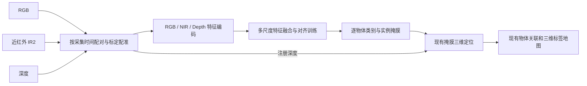

# 近红外多模态实例分割：选型与接入设计

核实日期：2026-11-08。本文保留最初的开源选型和近红外融合设计，最新 RGB-D 接入进展见下文。

后续进展：用户已选择先接入 RGB-D。EMSANet 的适配代码和独立启动入口已加入，安装与使用见 [EMSANet RGB-D 建图](emsanet_semantic_mapping.md)。以下近红外部分仍是后续设计，未加入当前模型。

## 目标与范围

- 输出类似 YOLOv8-seg 的物体类别和逐实例掩膜，继续生成地图中的三维物体标签。
- 让 RealSense 的近红外图像实际参与分割模型的推理，研究跨模态语义和实例对齐。
- 按用户要求，现有墙面提取、配置和显示保持原状，包括 `scripts/wall_geometry.py` 和 `scripts/map_geometry_node.py`。
- 复用现有 RTAB-Map 建图、物体三维定位、跨帧关联和回环后位置修正。首先离线验证新模型。

## 现有代码能做什么

| 位置 | 当前能力 | 新方案的接入需求 |
| --- | --- | --- |
| `src/rtabmap_semantic/rtabmap_semantic/detector.py` | `YoloDetector.detect(image)` 接收一张 RGB/BGR 图像，支持 `yolov8`、`yoloe_pf`，返回 `label/confidence/mask` | 增加可选的多模态后端，适配同样的逐实例输出 |
| `src/rtabmap_semantic/rtabmap_semantic/node.py` | `infer()` 先调用 `detect(rgb)`，再将掩膜和深度交给 `lift_mask()` | 新后端接收经过配对、配准的模态；明确输出掩膜所属的相机坐标系 |
| `src/rtabmap_semantic_msgs/msg/Keyframe.msg` | 保存节点身份、RGB、深度、相机内参和相机到节点的变换 | 近红外需要额外的图像、原始时间戳、内外参及有效区域信息 |
| `src/rtabmap_semantic/src/keyframe_bridge.cpp` | 从 `/mapData` 和保存的地图中取出 RGB-D，支持离线回放、去重及背压 | 需要为对应关键帧配套保存近红外，处理缺帧和回放 |
| `launch/realsense_depth_registration.launch.py` | 将原始深度注册到彩色相机视角 | 可复用几何基础；目前没有实现 IR2 到彩色视角的图像重投影 |
| `src/rtabmap_semantic/rtabmap_semantic/geometry.py`、`fusion.py` | 掩膜三维定位、物体关联、图优化后的重投影与持久化 | 复用；验证新后端类别、置信度及掩膜契约 |

因此，目前是“RGB 实例分割 + 深度几何定位”。仅开启 `enable_infra2:=true` 或显示近红外画面，不会让当前分割网络使用近红外。

## 已核实的开源基础

| 项目 | 官方任务和输入 | 对本项目的用途与限制 |
| --- | --- | --- |
| [EMSANet](https://github.com/TUI-NICR/EMSANet) | 双 CNN 编码器的 RGB-D 场景分析；同时输出语义与实例结果，并合成为全景分割；提供室内预训练权重 | 首选的现成 RGB-D 实例基线。可适配为逐实例掩膜；公开权重没有因此获得 NIR 输入能力 |
| [EMSAFormer](https://github.com/TUI-NICR/EMSAFormer) | 基于 EMSANet，用修改后的单个 Swin Transformer 处理 RGB-D；同样包含实例/全景分割 | 可作替代基线；需要独立测量本机耗时和内存，不能从论文 GPU 数据推断当前 CPU 性能 |
| [CMX](https://github.com/huaaaliu/RGBX_Semantic_Segmentation) | RGB-X 语义分割；包含通道/空间特征校正及跨模态特征融合 | 借鉴融合模块；默认语义头不直接输出逐物体实例 |
| [CMNeXt / DELIVER](https://github.com/jamycheung/DELIVER) | 任意模态语义分割；Hub2Fuse、多模态特征选择和融合；包括 MCubeS 实验 | 借鉴多模态扩展和缺失模态处理思路；数据集中有实例标注不代表模型默认实现实例分割 |
| [MCubeS / Multimodal Material Segmentation](https://github.com/kyotovision-public/multimodal-material-segmentation) | RGB、偏振、近红外的材质分割，提供数据与预训练模型 | 确实涉及 NIR，可参考配准、有效区域和模态融合；目标是材质类别，不是室内物体实例 |

注意 MCubeS 的 `RGB-A-D-N` 中，A/D 分别指线偏振角 AoLP 和线偏振度 DoLP，N 指近红外；这里的 D 不是深度。D435i 的近红外也不等同于热红外 RGB-T 数据。

EMSANet/EMSAFormer 的输出类别受训练集限制，不能直接继承当前 YOLOE 的词表。适配时必须建立类别映射，并仅将可数物体的实例交给物体标签流程。

目前没有核实到“已有匹配 D435i 的 RGB/NIR/深度预训练权重、能直接替换当前 YOLO 并输出通用室内实例”的完整开箱即用方案。这是本次核实的范围，不是断言不存在相关研究。

## 推荐路线

首选 EMSANet 作为可运行的 RGB-D 实例分割基线，再扩展近红外分支；最终目标为 RGB + NIR + Depth 的实例分割和三维标签。近红外扩展是本项目拟开发的部分，不是 EMSANet 官方现有功能。

选择这个起点是因为官方代码已经具备 RGB-D 训练、实例输出和室内权重，可以先验证它是否适合本机数据，再增加近红外分支。CNN 多分支也便于逐步检查各模态的贡献。

如果后续要求必须沿用 YOLO 模型结构，则备选是为 YOLOv8-seg 增加 NIR 编码器及多尺度融合模块。它同样需要修改数据加载、增强、模型和训练流程；普通 `yolov8*-seg.pt` 不能直接推理 RGB+NIR。

NIR+Depth 也可作为独立实验：将外观分支改为近红外并进行适配训练。把灰度复制成三通道只能匹配张量形状，不能替代 NIR 训练。

## 如何进行跨模态对齐

### 1. 时间对齐

按传感器采集时间配对 RGB、NIR、Depth，记录实际时间差、曝光和帧率；不能用网络到达时间配对。相同配置帧率不意味着已经同步，启用驱动同步选项也需要测量验证。

关键帧桥接会排队、延迟推理和回放。应在采集侧保存对应关系，查明 RTAB-Map 节点时间与源图像时间的关系；若源时间在消息转换中被覆盖，需要提前保存来源信息。不能简单把节点时间当作所有模态的原始时间戳。

### 2. 几何对齐

以 RGB 视角作为共同输出坐标系。使用深度相机内参反投影得到三维点，再通过相机间外参投影到 RGB 和 IR2，建立有效像素对应。

实现必须考虑当前流的内参、畸变或整流状态、分辨率、视场差异、遮挡及缺失深度。为越界、无深度和被遮挡区域保存有效性掩膜。IR2 是右侧红外视角，不能假定其像素与深度已经一一对应。

将 640×480 的 IR2 resize 为 RGB 尺寸只改变大小，不能消除相机基线造成的视差。

### 3. 学习语义和实例对应

为不同模态建立独立编码分支，在多个尺度使用可学习的特征校正、门控或跨注意力融合；可以参考 CMX 的 FeatureRectifyModule / FeatureFusionModule。使用同一组物体类别和实例掩膜训练最终输出。

如需显式研究对齐，可在有效重叠区域增加对象级特征投影和对比/一致性损失：同一个真实物体在不同模态中的特征构成正样本，不同物体构成实例级负样本。类别语义对齐和实例身份对齐应区分，避免把不同椅子的实例合并。仅在有可靠对应的区域施加约束，并保留各模态特有信息。

示意训练目标为：实例任务损失 + 带权的跨模态对齐损失。若采用 EMSANet，实例任务仍包含其中心点/偏移等原生监督。对齐损失是可评估的扩展，不是已有权重附带的能力，也不能仅凭加入注意力模块就声称对齐有效。

## 与现有工程的衔接

1. 先录制同步 RGB、IR2、原始深度、CameraInfo 和相机内外参，保留曝光、投射器状态等采集信息。D435i 主动投射器的散斑可能改变近红外外观，训练与测试需覆盖实际使用条件。
2. 先做独立的离线 RGB-D 实例推理适配器，返回现有 `label/confidence/mask` 契约；掩膜须还原到共同相机视角。全景分割置信度需定义和验证，不能直接套用 YOLO 的置信度阈值。
3. 为近红外增加独立的同步缓存和持久化记录。可采用新的多模态消息包装现有 Keyframe，保持原后端可选。缓存索引应包含地图身份、session、node、源时间和标定版本；仅凭 node_id 不足以避免地图重置后的混用。
4. 回放必须读取该关键帧当时保存的近红外。历史 RGB-D 地图没有 IR 数据时，要明确使用 RGB-D 后端或跳过，不允许拼接当前实时 IR。推理缺少模态时，只有经过相应训练/验证的模型才能走缺失模态分支。
5. 增加 NIR 分支并进行配对数据微调，输出适配到现有几何和物体融合流程。新模型/数据版本应使用独立的语义存储或版本标识，避免旧结果去重缓存阻止重新推理或混合不同类别体系。
6. 模型环境与 ROS Python 环境隔离。EMSANet 当前文档列有 Python 3.12 / PyTorch 2.10 等环境，以及旧版选项；应固定可复现版本，先测实际推理成本，再决定进程间接口和部署位置。

## 数据与验收

NIR 实例模型需要同步配对数据及目标场景的逐物体实例标注。可以用 RGB 模型辅助产生预标注，但须人工检查，特别是低照度、小物体、遮挡和 RGB 模型漏检的区域；独立测试集不能只用同一个教师模型的伪标签评测。

按场景或采集序列划分训练、验证和测试集，避免相邻视频帧分到两边造成虚高指标。对照实验应控制标签集合、数据划分和训练预算：

- RGB、NIR 单模态；RGB-D、NIR-D；RGB+NIR；最终 RGB+NIR+D。
- 在选定主模型上对照有无显式对齐损失，区分模态增益与模型容量增益。
- 记录逐实例 mask AP、全景输出的 PQ（若采用）、按类别召回率；三维标签的重复/误合并率、定位误差和跨帧身份稳定性。
- 分别记录正常光照、低照度、运动和无效深度区域；记录配对成功率、时间差分布、延迟、内存和关键帧积压。

现有语义配置默认 CPU，尚未实测这些候选模型在本机上的吞吐率。融合效果、实时性和夜间提升都需要上述实验验证。

## 本次产出

仅新增本设计文档。未下载模型权重、改变检测器或消息定义、启动训练，也未改动墙面代码和运行中的 SLAM。

参考：上述链接均为本次读取的官方仓库。CMX 融合实现另见 [models/net_utils.py](https://github.com/huaaaliu/RGBX_Semantic_Segmentation/blob/main/models/net_utils.py)；MCubeS 模态定义见其 README 的 “Details of MCubeS dataset”。
