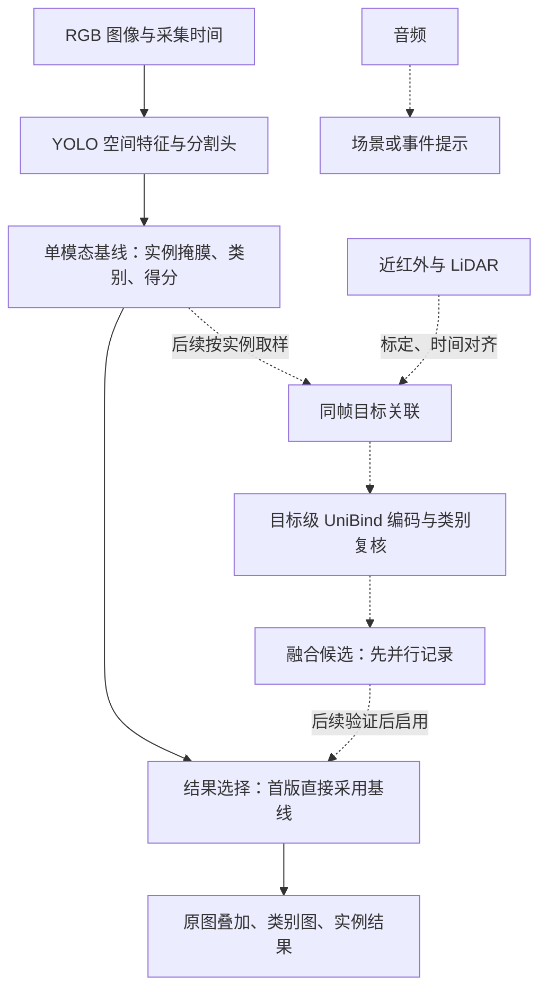

**YOLO 分割接入方案（设计依据）**

独立分割、MITI 显示及融合请求/候选/选择器现已实现，实际接口说明见 [yolo_segmentation.md](yolo_segmentation.md)。真实 RGB＋近红外目标级 UniBind 融合、同步采集与评估现已接通，见 [segmentation_fusion.md](segmentation_fusion.md)。本文保留设计阶段规划。

本阶段先接通相机图像到分割显示，保留后续多模态融合接口；融合精度暂不作为本阶段验收项。分割节点独立运行，不依赖地图关键帧，也不读写地图数据库。

建议首版使用本地 `models/yolov8n-seg.pt`，以 RGB 分割作为固定基线；现有 YOLOE 后端保留为可选模型，分别使用已有运行环境。选择较小的 YOLOv8n 是为了先验证流程，实际速度和现场效果仍需测量。

**模型能力与接入位置**

现有 [YoloDetector](../src/rtabmap_semantic/rtabmap_semantic/detector.py) 已加载分割权重，输出每个实例的二值掩膜、类别名称和置信度。原始结果中的类别编号、检测框目前未向外保留，需要增加字段。现有 [SemanticMapper](../src/rtabmap_semantic/rtabmap_semantic/node.py) 则订阅地图关键帧、结合深度定位并写入语义数据库，不适合作为本次独立分割入口。

YOLO `*-seg` 做的是实例分割。首版可以将同类实例合成物体类别语义图，例如分别得到两个人的掩膜，再在类别图中都标为“人”。YOLOv8 的 COCO 80 类不覆盖墙面、地面、天花板等完整场景类别；未覆盖像素标为“未知”，不能自动解释为已识别背景。若任务需要逐像素覆盖这些区域，应另选适合该词表的语义分割模型或训练数据；项目已有 EMSANet 路径可以另行评估。

首版实线路径即可独立出结果。虚线路径是后续扩展，不意味着当前已有多模态分割能力。

**输入、中间表示和输出**

| 环节 | 数据与约定 |
| --- | --- |
| 输入 | `/camera/color/image_raw`，`sensor_msgs/Image`；转为模型需要的 BGR 图像，保留原始宽高、采集时间和光学坐标系。 |
| YOLO 中间表示 | 主干与特征金字塔保留二维位置的多尺度特征图；分割头据此生成实例掩膜。输入缩放、补边参数用于核对掩膜与原图位置。 |
| 实例输出 | 帧内 `instance_id`、模型原始 `class_id`、统一任务类别、名称、原始实例置信度、原图坐标系下的 `bbox_xyxy` 和二值掩膜。置信度不是逐像素正确率。 |
| 类别图 | 原图大小的 `32SC1` 图像；像素值为任务类别 ID，`-1` 表示未知。类别 ID 为 0 的真实类别仍有效。 |
| 实例图 | 原图大小的 `32SC1` 图像；`0` 表示无实例，正整数关联本帧实例表。实例 ID 不表示已经实现跨帧跟踪。 |
| 显示图 | 在对应的原始 RGB 帧上绘制彩色半透明掩膜和简短类别名，输出 `rgb8`。 |

保留原始实例掩膜，包括实例间的重叠。只有生成单值类别图、实例图时处理重叠：采用实例置信度较高者，同分按帧内 ID 决定，并固定该规则。这个处理是确定性显示规则，不代表遮挡关系推断。

当前 UniBind 的全局 `1024` 维融合向量没有逐像素位置，不能直接接到现有 YOLO 分割头就产生掩膜。后续若要让融合改善分割边界或找回 YOLO 漏掉的目标，需要保留空间特征、增加对齐与分割结构，并进行任务训练和验证。

**建议接口与代码落点**

以下名称均为拟新增接口。

| 位置或话题 | 作用 |
| --- | --- |
| `src/rtabmap_semantic/rtabmap_semantic/segmentation_node.py` | 新建独立图像分割节点，复用 `YoloDetector`，不实例化 `SemanticMapper`。 |
| `src/rtabmap_semantic/rtabmap_semantic/detector.py` | 加法式保留类别编号、框坐标等字段，维持现有调用方的掩膜、类别和阈值行为。 |
| `src/rtabmap_semantic_msgs/msg/SegmentationInstance.msg`、`SegmentationFrame.msg` | 新增图像分割数据契约；与地图对象消息分开。 |
| `/perception/segmentation/baseline` | 原始 RGB 单模态帧结果，作为比较依据。 |
| `/perception/segmentation/candidate` | 后续融合候选；首版不发布伪造候选。 |
| `/perception/segmentation/selected` | 对外采用的结果，首版实例、掩膜、类别和得分与 baseline 完全一致。 |
| `/miti/segmentation/overlay` | 标准 `sensor_msgs/Image`，提供分割叠加图。 |
| `/miti/segmentation/class_image` | 类别图的彩色预览；算法使用的整数类别图保留在帧消息中。 |
| `/miti/segmentation/status` | 标准 `std_msgs/String` JSON，含帧标识、运行状态、输出来源、目标数、帧龄及耗时。 |
| 独立 launch、配置与 `scripts/start_yolo_segmentation.sh` | 显式启动分割，选用已有 `.venv-semantic`；可选 YOLOE 时使用 `.venv-yoloe`。不复用会启动建图的脚本。 |

`SegmentationFrame` 将实例表和两张整数图放在同一消息内，避免下游将不同帧拼在一起。每个实例保留框内 `mono8` 掩膜及其原图偏移，以表达重叠并控制体积；整数图只提供单值视图。

帧消息还需包含原图尺寸、模型哈希、参数/词表版本、结果来源、处理状态和耗时。统一关联键采用运行会话 ID、单调帧序号、原始 ROS 采集时间（秒和纳秒）及来源相机；`header.stamp` 始终是采集时间，不能改成推理完成时间。后续候选须携带完全相同的来源键、实例 ID 和基线版本。

后续类别复核所需的原图由有界缓存或显式取样消息提供；不能从已经画过掩膜的叠加图重新裁剪。自定义算法话题用于节点间通信；MITI 使用标准图像和 JSON 消息，沿用当前 `/miti/` 展示通路。

**后续如何接 UniBind**

1. 以某一帧的 YOLO 实例掩膜和框为锚，提取该目标的 RGB 区域，记录裁剪与补边方式。
2. 使用时间戳、相机内外参和所需深度几何关联近红外区域；LiDAR 点经过外参投影、遮挡与深度一致性筛选后，取得该目标的点集。不能仅复制 RGB 框坐标到近红外，也不能把整片场景点云当作该物体。
3. 对每个有效目标分别调用现有 UniBind 骨干，得到 RGB、近红外、点云各自的 1024 维向量。当前 `/multimodal/features` 是整场景观测，缺少实例身份，不能直接复用于每个目标。
4. 增加统一任务词表和分类适配器，准备并验证对应类别中心或分类头，再产生各分支及融合分支的类别得分。当前应用只有特征输出，`.tools/unibind/centre_embs` 仅有说明文件，不能假设分类已接好。不同模型的原始置信度、余弦相似度须保留来源，未经校准不直接比较或相加。
5. 初期复核分支只提出类别建议，保留 YOLO 掩膜及框。音频先作为独立场景/事件信息；尚无声源定位和实例关联时，不把整段声音分配给某个物体并改写其类别。

当前 [配置](../config/fourmodal_features.yaml) 的 `calibration_version` 为 `unverified`，50 ms 是匹配容差，不能当作实测同步精度。近红外通过灰度复制三通道进入视觉编码器，其目标识别效果仍需验证。现有点云预处理要求至少 512 个有效不同点；目标点云不足、视野不重叠、关联不可靠或数据过期时，将该模态标为无效，而不是强行凑齐四路。

**怎样预留“融合不低于最佳单模态”**

接入时同时保留 baseline、candidate、selected 三种结果和原始模态有效性。首版 `selected = baseline`；融合功能关闭或尚无有效候选时，输出原始 RGB 结果，不通过二次阈值或重分类改变它。未来先开启候选并行记录，收集同帧对照，再决定是否让候选参与正式输出。

后续选择策略需要检查数据新鲜度、标定、实例关联、类别适用范围及校准后的模型可靠性；不满足条件时采用基线。仅凭“融合得分更高”或“四路都在线”不能判定结果更准确。即使通过这些检查，类别修改仍可能降低分割指标，因此门控和回退只降低风险，不构成准确率保证。

上述直通方式能保持已接入 RGB 基线的同帧预测，并不证明融合优于所有单一模态。将来评估时，要为参评模态定义同一分割任务、类别空间和标注口径：实例分割采用 mask AP，合成的类别语义图采用 mIoU/各类 IoU。音频场景分类或点云分类不能直接与 RGB 分割比较。若点云分割参与像素指标比较，需要明确统一投影与有效区域规则。

正式目标可表达为 `融合指标 − 最佳单模态指标 ≥ 0`。模型和选择规则在验证集确定后，以同一独立测试集逐帧成对比较，并检查昼夜、遮挡、缺失模态等场景及统计不确定性。若以后允许非零容差，需单独明确，不能把“略有下降”记作“不低于”。这些精度工作放在后续阶段，本阶段只保留复现实验所需的输入引用和结果来源。

**运行与展示**

YOLO 独立进程推理，订阅队列及等待槽有界：一个正在处理的帧加一个最新待处理帧，新帧替换未处理旧帧并记录丢弃数。缺少近红外、LiDAR 或音频不阻塞 RGB 分割。未来 UniBind 使用独立调度和资源预算；已有 CPU 四模态记录约每组 4–5 秒，目标级多次编码需重新测量，不能串行阻塞每帧 YOLO。场景和目标编码应规划共享一个常驻模型工作进程，避免重复加载大模型；资源不足时暂停复核。

叠加图始终绘制在其推理来源图像上。迟到的候选只用于其原始帧的冻结对比或记录，不覆盖最新相机帧。正常空检测也发布有效空结果；推理失败、无输入、数据过期分别显示状态，避免把旧掩膜当作实时结果。

MITI 新增简洁的“目标分割”视图，默认显示掩膜叠加，只保留原图/叠加/类别图切换和目标数、耗时、状态。框和详细置信度按需展开。后续候选存在时才提供同帧基线/候选比较，明确标出输出来源；原有“四模态 · 特征融合”仍表示全局特征。布局继续遵守已有隐藏地图面板的设置。

**实施顺序与本阶段验收**

先完成 RGB 分割节点、消息和 MITI 显示，再实现候选与选择接口，最后按标定和算力条件逐项增加目标级复核。前两项现已实现，生产用目标级 UniBind 复核器仍需后续接入。

实际实施时验证：原图与掩膜对齐（含非方形图像和补边）、框与掩膜尺寸有效、重叠规则确定、类别 0 与未知不混淆；空检测和相机断流状态正确；图像和元数据同帧；推理积压不会持续增长；候选缺失、错误或过期时采用原始基线；独立入口没有地图数据库和建图启动依赖。模型精度与吞吐率使用真实样本分别记录，不将接口通过称为融合精度达标。
